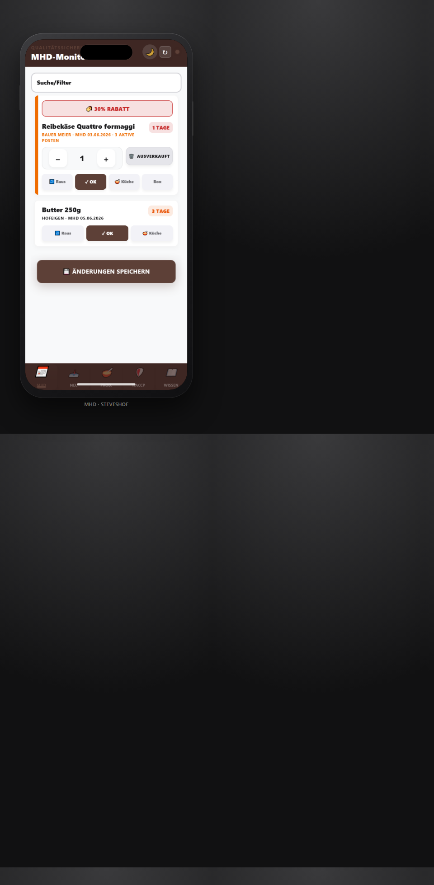
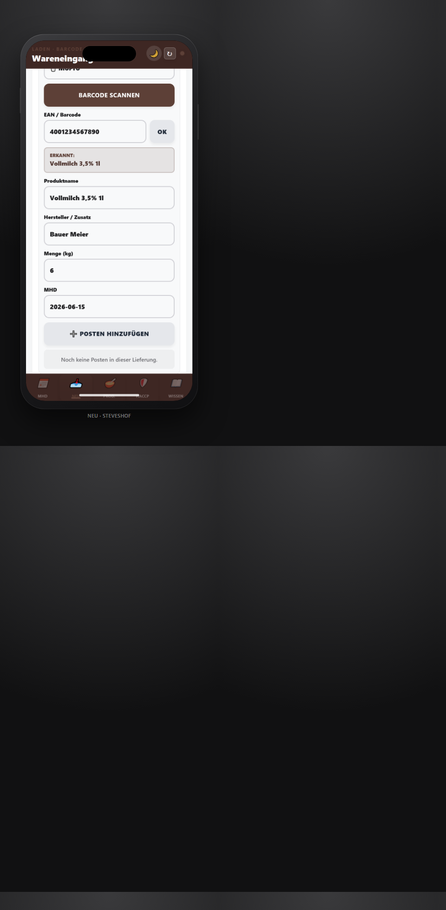
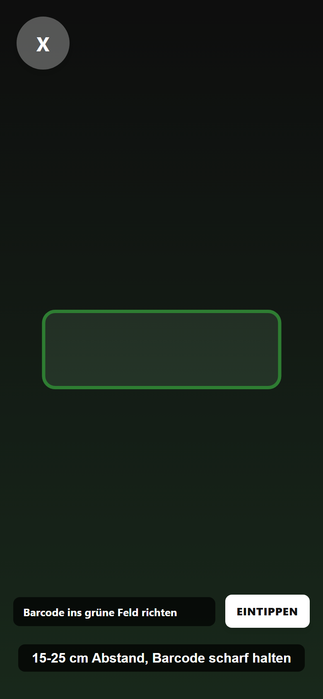
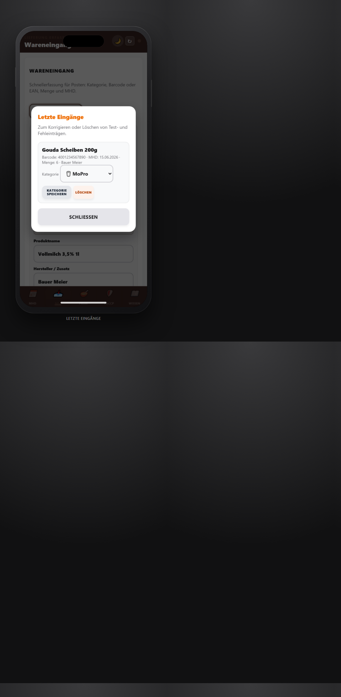
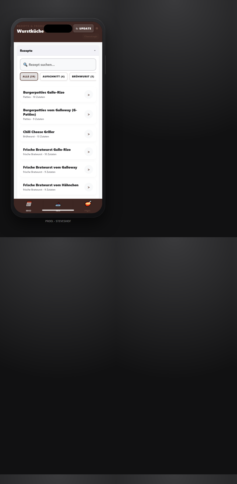
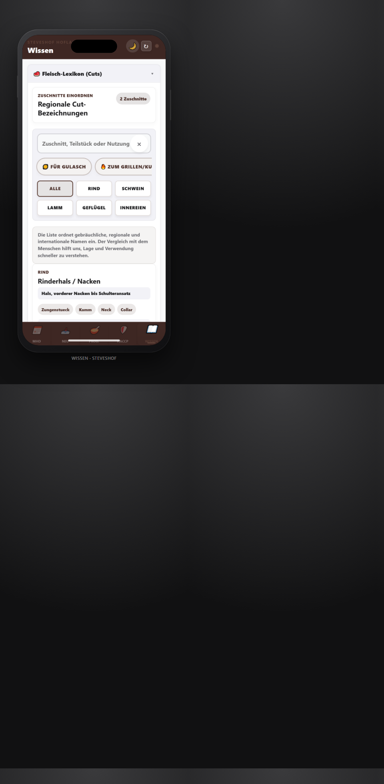
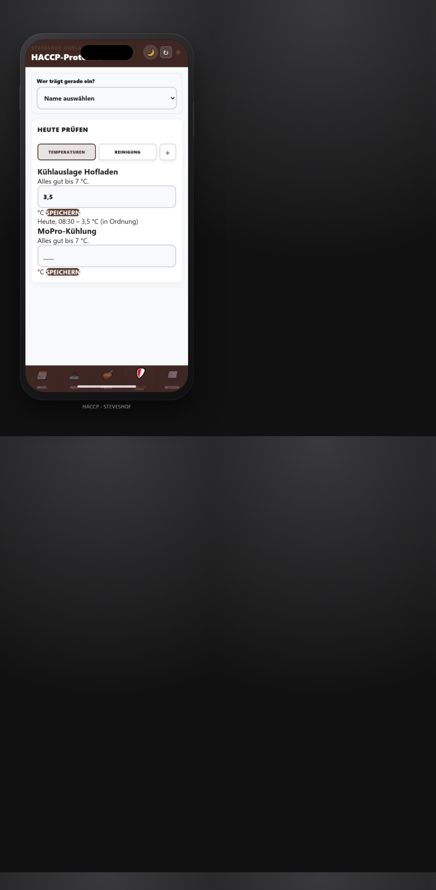

# StevesHof Hofladen: Kurzanleitung für unser Team

Diese Anleitung gilt für unseren Hofladen bei **StevesHof**. Unsere App heißt **CharcuLogic** und ist im Laden bewusst auf die wichtigsten Aufgaben reduziert:

1. **MHD kontrollieren** (inkl. Retter-Box vormerken)
2. **Neue Ware erfassen** (Barcode-Scan, Lieferung abschließen)
3. **Fleisch-Herkunft erfassen** (LMIV / Thekenklade)
4. **Rezepte und Produktion öffnen**
5. **Temperaturen und Reinigung dokumentieren** (HACCP)
6. **Auskunft nachschlagen** (Allergene, Zutaten, Fleisch-Lexikon)

Nach dem Öffnen starten wir direkt in der **MHD-Kontrolle**.

> **Navigation (Kurz):** Primär **MHD · Neu · Packtisch · Herkunft · Mehr** · unter Mehr u. a. **HACCP** und **Auskunft** · Thekenklade unter **Herkunft** · Büro/Verwaltung nur über ⚙️ (Büro/Admin). Ausführlich: [NAVIGATION.md](./NAVIGATION.md).

## Anmeldung am Laden-iPhone

Unser **Laden-iPhone** hat zwei Stufen — **Geräte-Zugang** (einmalig) und **Profil** (pro Schicht oder Kollege).

### 1. Geräte-Zugang (einmal am Laden-iPhone)

```text
bestellung@steveshof-hofladen.de
```

Das Passwort verwalten wir intern. Diese Anmeldung bleibt auf dem Laden-iPhone gespeichert. Eine **PIN** brauchen wir im Hofladen nicht.

### 2. Profil wählen (vor MHD, Wareneingang und Herkunft)

Nach dem Geräte-Zugang — oder wenn unsere App danach fragt — wählen wir **unser Profil**, z. B. Bettina, Finn, Stephie, Nicole, Heiko, Paddy, Melanie, Efecan oder Mimi. Über **Andere** können wir einen Namen eintippen, falls wir nicht in der Liste stehen.

- Das gewählte Profil erscheint **oben rechts** in der App (👤 Name). Ohne Auswahl steht dort **👤 TEAM**.
- Zum **Schneller Wechsel** tippen wir oben rechts auf den Namens-Button (👤 …) — die Mitarbeiter-Liste öffnet sich erneut. **✕** schließt nur, wenn bereits ein Name gewählt ist.
- Für **MHD**, **Neu** (Wareneingang), **Packtisch** und **Herkunft** ist ein Name **Pflicht** — ohne Auswahl lässt sich das Fenster nicht schließen.
- Nach **zehn Minuten ohne Tippen** sperrt unsere App den Bildschirm und fragt erneut nach dem Namen.

**Wichtig:** Safari **nicht** im privaten Modus nutzen — sonst vergisst das Laden-iPhone den Geräte-Zugang nach dem Schließen.

## Navigation

Oben zeigt unsere App den **aktuellen Betrieb** (Name + Logo). In der unteren Leiste sehen wir im Hofladen typischerweise:

| Tab | Zweck |
|-----|-------|
| **MHD** | Haltbarkeiten prüfen und Ware bearbeiten |
| **Neu** | Wareneingang: Posten scannen und Lieferung abschließen |
| **Herkunft** | Fleisch-Etikett fotografieren und LMIV-Herkunft; Unterseite **Thekenklade** |
| **Mehr** | Overflow: u. a. **HACCP**, **Prod.**, **Etiketten**, **Auskunft** |

Unter **Mehr** (wenn freigeschaltet): **Start**, **Team**, **HACCP**, **Prod.** (Rezepte, Produktion, WRS), **Etiketten** (Avery), **Auskunft** (Theken-Auskunft / Allergene & Zutaten).

**Büro** und **Retter-Box** öffnen wir bei Bedarf über das **Verwaltungs-Menü** ⚙️ oben (nur Büro/Admin am Smartphone) bzw. die **Admin**-Leiste am Desktop. Den Eintrag **Verwaltung** (`/dev-dashboard`) sehen nur **Betriebs-Admins** — andere Zugänge werden zur Haupt-App zurückgeleitet. Unter **/dev-dashboard**: **Übersicht**, **Nutzer**, **Mein Betrieb**, **Protokoll** (Warenbewegungen, CSV-Export, Einträge korrigieren). Auf der Übersicht liegen Sprungmarken zur Thekenklade, Retter-Box und Auskunft — kein eigener Tab „Rückverfolgbarkeit“.

Auf großen Bildschirmen erscheint die Navigation als **linke Seitenleiste** mit **Laden-Alltag** und **Admin**.

---

## 1. MHD-Kontrolle

Im Tab **MHD** startet unsere App in der Ansicht **Alle (7 Tage)**: alle fälligen Posten der nächsten sieben Tage, sortiert zuerst nach **Dringlichkeit** (Überfällig / Heute / Morgen / …), unabhängig von der Warengruppe. Mit den Filter-Buttons können wir gezielt nur **MoPro (0-2 Tage)**, nur **Kühlware (0-2 Tage)** oder nur **Trockenware (0-30 Tage)** prüfen. Tippen wir auf die Ampel **IN x TAGEN**, zeigt unsere App das genaue MHD-Datum.

Die Rabatt-Empfehlung auf der MHD-Karte richtet sich nach der **MHD-Rabattstaffel** unseres Betriebs. Die Vorlage lautet:

- **Milch (Flasche/Tetrapack):** 1 Tag vorher **10 %**, am MHD-Tag **20 %**, sonst **Regulär**
- **Kühlware / MoPro / Frische / Fleisch:** 2 Resttage **10 %**, 1 Resttag **20 %**, am MHD-Tag **50 %**, sonst **Regulär**
- **Trockenware / TK / Gewürze / Getränke:** ≤30 Tage **10 %**, ≤15 Tage **20 %**, ≤7 Tage **50 %**, sonst **Regulär**

Ohne Rabatt zeigt die Karte unauffällig **Regulär** (kein %-Badge). Die Staffel stellen wir in der Verwaltung unter **Mein Betrieb → MHD-Rabattstaffel** ein — jeder Betrieb für sich.

Wenn eine Kategorie falsch ist, tippen wir in der MHD-Karte **✏️ Bearbeiten** oder das Kategorie-Badge an. Unter **Artikel-Stammdaten bearbeiten** korrigieren wir Bezeichnung, Marke, EAN und die Zuordnung zu **MoPro & Kühlware** oder **Trockenware**. Nach dem Speichern zeigt unsere App den Artikel im passenden Filter.

Wenn ein MHD falsch erfasst wurde, tippen wir **MHD ändern** in der Karte. Unsere App korrigiert nur diesen Eintrag und fragt vor dem Speichern noch einmal nach.

1. CharcuLogic öffnen — der Tab **MHD** erscheint von selbst.
2. Bei Bedarf die Prüfgruppe wählen: **Alle (7 Tage)**, **MoPro**, **Kühlware** oder **Trockenware**.
3. Kritische Artikel nacheinander bearbeiten:
   - **OK**: Ware bleibt im Verkauf.
   - **Raus**: Ware wird aus dem Verkauf genommen.
   - **Küche**: Ware geht zur weiteren Verwendung (nur sichtbar, wenn in der Verwaltung unter **MHD-Karten-Aktionen** freigeschaltet).
   - **Ausverkauft**: Posten ist nicht mehr vorhanden.
4. Die Menge bei Bedarf mit **− / +** oder direkt im Zahlenfeld korrigieren.
5. **Änderungen speichern** tippen.

Optional nutzen wir **Artikel suchen**, um gezielt nach einem Produkt zu filtern.

### Retter-Box vormerken

Ware, die wir als **Retter-Box** verkaufen wollen, markieren wir direkt in der MHD-Karte mit **Box** — sofern der Button in der Verwaltung unter **MHD-Karten-Aktionen** eingeblendet ist. Kurz erscheint **Zur Retter-Box gelegt** — der Posten ist im heutigen Vorschlag gespeichert.

**Drucken**, Rezeptvorschlag und Status (**Verkauft** / **Verwerfen**) erledigen wir im **Büro-Bereich** mit Admin-Zugang unter **Retter-Boxen**. Am neutralen Laden-iPhone nutzen wir nur die **Box**-Aktion in der MHD-Karte.



---

## 2. Neue Ware erfassen (Wareneingang)

Im Tab **Neu** erfassen wir Ware beim Einräumen — im Modus **Laden**. Oben wählen wir den **Lieferant**. Die Posten sammeln wir in einer **Lieferung** und schließen sie am Ende mit **Gesamte Lieferung abschließen** ab.

1. Tab **Neu** öffnen — bei Bedarf zuerst **unser Profil** wählen.
2. **Lieferant** wählen (Weiling, Naturverbund, Stautenhof, Sonstige oder Eigenproduktion).
3. Einmal die passende **Kategorie (Laden)** wählen:
   - Frische
   - MoPro
   - Kühlware
   - Aufschnitt
   - TK
   - Getränke
   - Trockenware
   - Gewürze
4. **Barcode scannen** (grüner Button) oder EAN eintippen und **OK** tippen.
5. Bei bekannter EAN: der Posten erscheint sofort als **oberste Karte** (mit vorgeschlagenem MHD); der Scanner bleibt für den nächsten Artikel bereit.
6. Bei unbekannter EAN den **Produktnamen** ergänzen, Menge/MHD setzen und **➕ Posten hinzufügen**.
7. Optional **Hersteller / Zusatz** eintragen (z. B. Bauer Meier) — erscheint später auch in der MHD-Karte.
8. Auf der Karte Menge (Tap → Nummernpad), MHD (+3/+7/+14 oder Datum tippen) oder **✕** zum Entfernen nutzen.
9. Den nächsten Artikel scannen — ohne nach unten zu scrollen.
10. Wenn alle Artikel der Lieferung drin sind: **💾 Gesamte Lieferung abschließen** tippen.
11. Unsere App fragt **Liste nochmals prüfen?** und zeigt die Posten kurz an. Mit **Jetzt abschließen** buchen wir sofort; mit **Liste prüfen** korrigieren wir Menge/MHD auf den Karten und tippen danach erneut abschließen.
12. Bei Erfolg erscheint **Gesamte Lieferung erfolgreich gebucht!** — die Posten landen im **MHD-Monitor**.

Fehlt der Lieferant beim Abschließen, öffnet unsere App ein Pop-up mit **Weiling**, **Naturverbund**, **Stautenhof** und **Sonstige**. Erst nach der Auswahl wird die Lieferung gebucht.

### Wichtig: Kategorie bleibt erhalten

Die gewählte Kategorie bleibt für den nächsten Scan aktiv. Wenn wir gerade nur MoPro verräumen, müssen wir **MoPro** nicht bei jedem Scan neu wählen.

Die Kategorie können wir jederzeit ändern — sie gilt für den **nächsten** Posten. Neue Posten stehen immer **oben** in der Liste.

---

## 2b. Fleisch-Herkunft erfassen (LMIV)

Im Tab **Herkunft** hinterlegen wir die gesetzliche Fleisch-Rückverfolgbarkeit für die Theke:

1. Tab **Herkunft** öffnen — bei Bedarf zuerst **unser Profil** wählen.
2. **Etikett fotografieren / scannen** — die Kamera des Laden-iPhones öffnet sich. Unsere App liest das Etikett per KI vor; wir prüfen die Felder kurz.
3. **Charge / LOT-Nummer** eintragen (Pflicht).
4. Optional das **Identitätskennzeichen** (ovales Kennzeichen) ergänzen.
5. Optional **Öko-Kontrollstelle** (z. B. DE-ÖKO-006) und **Bio-Verband** wählen.
6. **Tierart** wählen (Rind, Schwein, Geflügel, Schaf, Ziege).
7. Bei **Ursprung aus einem einzigen Land** nur das Land wählen. Sonst die Mehrländer-Felder ausfüllen (bei Rind zusätzlich Geboren/Zerlegt inkl. Zulassungsnummer).
8. **Herkunft speichern** tippen — der Eintrag ist danach **aktiv in der Theke**.

Ohne WLAN speichert unsere App den Eintrag lokal und synchronisiert automatisch, sobald WLAN wieder verfügbar ist.

Die **Digitale Thekenklade** öffnen wir unter **Herkunft → Thekenklade** (Suche nach LOT/Datum, Status umschalten, Original-Etikett öffnen). Deep-Link: `/#thekenbuch`. Von der Verwaltungs-Übersicht gibt es eine Sprungmarke dorthin.

---

## 2c. Zerlege-Etiketten (Tab Etiketten)

Im Tab **Etiketten** bereiten wir Avery-3475-Bögen für die Zerlegung vor. Am Laden-iPhone erfassen wir die Liste; drucken tun wir am **Laden-PC** mit Laserdrucker (A4, Ränder 0).

1. Tab **Etiketten** öffnen.
2. Unter **Ohrmarke / LOT aus Herkunft** einen aktiven Thekenbuch-Eintrag wählen und **In Kopfdaten übernehmen** tippen.
3. Offene Mengen aus **Heute zu zerlegen/packen** mit **Packliste auf den Bogen** übernehmen – oder eine Siegelrandbeutel-Notiz einfügen.
4. Vorschau prüfen und am Laden-PC **Etikettenbogen drucken**.

Die gemeinsame Druckliste synchronisiert sich zwischen Laden-iPhone und Laden-PC.

---

### Wareneingang per Barcode (Tab Neu)

Im Tab **Neu** erfassen wir Lieferungen zuverlässig per **Barcode-Serien-Scan**:

1. Lieferant wählen und Artikel nacheinander scannen (neueste Posten stehen oben).
2. Menge und MHD direkt auf der Karte korrigieren (Touch-Pad / Schnelltasten).
3. Lieferung abschließen oder als offenen Entwurf speichern.

**Umverpackungen / Kartons:** Manche Lieferanten drucken lange Strichcodes mit Klammern wie `(01)…(15)…(10)…`. Wir halten das Laden-iPhone etwas weiter weg (ca. 25–40 cm). Die App liest die Artikelnummer und – wenn der Code es enthält – auch das MHD. Wenn die Kamera trotzdem stockt, tippen wir die Zahl unter dem Strichcode ein.

Der frühere KI-Lieferschein-Scan ist in der Laden-App deaktiviert; der Fokus liegt auf dem schnellen Barcode-Flow.

### Zuordnung nachträglich korrigieren

1. Im Tab **Neu** auf **Letzte Eingänge** tippen.
2. Beim gewünschten Artikel die Kategorie prüfen.
3. Bei Bedarf eine andere Kategorie auswählen.
4. **Kategorie speichern** tippen.

So berichtigen wir falsch zugeordnete Artikel ohne Zugriff auf die technische Datenbank. **Letzte Eingänge** ist für uns im Hofladen direkt sichtbar — ein Büro-Login ist dafür nicht nötig. (**Stammdaten** und andere Büro-Funktionen sind im Laden-Modus ausgeblendet.)





---

## 3. Prod. öffnen

Im Tab **Prod.** nutzen wir Rezepte, Produktion und WRS-Kalkulation.
Mit dem Kategorie-Button unter der Rezeptsuche grenzen wir die Rezeptliste im Filterblatt ein.
Im Rezept stellen wir die Tagesmenge ein – bei Standardchargen über die Schnellwahl **8 / 12 / 16 / 20 kg** (Standard: Alexanderwerk / OSKAR 20: **16,0 kg**), z. B. für die **Bio-Galloway Rostbrat- & Currywurst**. Das **Druckdatenblatt DIN A4** öffnet zwei Seiten mit Fleischeinsatz, Gewürzen, Etikettentext und HACCP-Prüfpunkten.



---

## 4. Auskunft nachschlagen

**Auskunft** öffnen wir unter **Mehr** (wenn freigeschaltet). Seitentitel: **Theken-Auskunft**. Dort gibt es aufklappbare Bereiche:

- **🧾 Theken-Auskunft (Allergene & Zutaten)**: Wir suchen Artikel oder Zutaten und tippen einen Treffer an – Allergene, Verkehrsbezeichnung und kundenkonforme Zutatenliste erscheinen sofort (auch offline aus dem gespeicherten Katalog).
- **🥩 Fleisch-Lexikon (Cuts)**: Wir suchen nach Zuschnitten, regionalen Namen und passenden Verwendungen.
- **📋 Hofladen-Handbücher**: Wir lesen die kurzen Anleitungen zu MHD-Ablauf-Regeln, Reinigung der Wurstküche und HACCP-Erklärung.

Die Filter im Fleisch-Lexikon sind für das Laden-iPhone groß genug, damit wir sie auch im Arbeitsalltag sicher treffen.



---

## 5. Kundenbestellungen zusammenstellen

Wenn das Modul **Packtisch / Kundenbestellungen** freigeschaltet ist, sehen wir am Laden-iPhone unter **Packtisch** zuerst ein **Dashboard** (fällig/heute, offen, in Bearbeitung, abholbereit) und den **Abhol-Kalender** (zwei Wochen oder Monat). Tippen auf eine Dashboard-Kachel oder einen Kalendertag filtert die Liste.

Unter **Vergangene** sehen wir abgeholt/stornierte Bestellungen der letzten Tage sowie eine einfache Auswertung der **meistbestellten Produkte** – filterbar nach Zeitraum und Wochentag.

Beim Aufnehmen mit Bestellzettel-Foto zeigt unsere App während des Hochladens **Zettel wird hochgeladen…** und danach eine klare Erfolgsmeldung – auch wenn das Speichern etwas dauert.

1. Unter **Packtisch** den gewünschten Status im Dashboard oder den Abholtag im Kalender wählen – oder im Bürobereich die **Sammel-Pickliste für heute** öffnen.
2. Unsere App fasst gleiche Artikel aus allen offenen Bestellungen zusammen, zum Beispiel `12 Glas Fleischsalat`.
3. Wir holen die Artikel nach Bereich, etwa **Wurstküche**, **Molkereiprodukte** oder **Hofladen-Spezialitäten**.
4. Beim Einpacken haken wir jede Zeile ab und korrigieren bei Bedarf den **Waagen-Wert**.
5. Wenn alles im Laden-Kühlschrank steht, markieren wir die Bestellungen als **Abholbereit**.

Nach der Bestätigung setzt unsere App die enthaltenen Bestellungen auf **Abholbereit**, speichert erfasste Waagen-Werte in den Bestellpositionen, schreibt automatisch eine kurze Info aufs Schwarze Brett und kann das **Kunden-Signal** als freundliche **Abhol-Nachricht** schicken. Am Packtisch entscheiden wir dabei, ob eine **E-Mail** (später auch SMS/WhatsApp) rausgeht – oder wir markieren **ohne Nachricht**. Die Nachricht nennt die Abholung **ab** der genannten Uhrzeit (nicht „um“). Danach ist die Sammel-Pickliste für heute leer, solange keine neue offene Bestellung dazukommt.

Ruft ein Kunde an und möchte etwas ändern, tippen wir **Bearbeiten / erweitern** – auch bei bereits laufenden oder abholbereiten Bestellungen. Speichern setzt abholbereite oder erledigte Aufträge wieder auf **In Bearbeitung**. Bei abholbereiten Bestellungen können wir außerdem **Details / Nachwiegen**, **Zurück in Bearbeitung** oder **Kunde erneut benachrichtigen** wählen. Der **Lieferschein** / **Kisten-Zettel** zeigt Kundennamen, Abholdatum, bestellte Menge, tatsächliche Menge und den **Endpreis**. Wenn wir einen Waagen-Wert erfasst haben, nutzt unsere App diesen Wert für den **Abholpreis**.

Wenn der Kunde die Kiste mitnimmt, tippen wir **Als abgeholt markieren**. Unsere App zieht die tatsächliche Menge vom Lager ab und zeigt **Bestand aktualisiert**, sobald alles verbucht ist.

---

## 6. Temperatur-Check (Qualität sichern)

**HACCP** öffnen wir unter **Mehr** (wenn freigeschaltet). Dort tragen wir die aktuellen Werte unserer Kühlstellen ein und dokumentieren Reinigungen.

1. **HACCP** öffnen.
2. Wir sehen je Kühlstelle eine Karte, zum Beispiel **Kühlauslage Hofladen** oder **TK-Truhe**, mit dem Hinweis, welcher Wert in Ordnung ist (z. B. *„Alles gut bis 7 °C.“*).
3. Den gemessenen Wert in das große Feld **„____ °C“** eintippen.
4. **Speichern** tippen. Es erscheint kurz **Wert gespeichert**.

Ist ein Wert zu hoch – zum Beispiel die Kühlung über 7 °C – färbt sich das Feld dezent orange und wir sehen sofort den Hinweis **„⚠️ Wert erhöht! Bitte Kühlung prüfen.“**. Den Wert speichern wir trotzdem, damit nichts verloren geht, und kümmern uns gleich um die Kühlung.

Unter jeder Karte steht der zuletzt eingetragene Wert (z. B. *„Heute, 08:30 – 3,5 °C (in Ordnung)“*), damit wir auf einen Blick sehen, was heute schon kontrolliert wurde.

Ohne Internet ist das kein Problem: Unsere App zeigt dann **Lokal vorgemerkt** und überträgt den Wert automatisch, sobald WLAN wieder verfügbar ist.



---

## Liefertag: Kurzfassung

1. CharcuLogic öffnen — **Profil** wählen, falls gefragt.
2. **MHD**-Kontrolle erscheint automatisch; offene Punkte bearbeiten und **Änderungen speichern**.
3. Zu **Neu** wechseln (ggf. erneut Profil bestätigen).
4. Kategorie für die aktuelle Warenart einmal wählen.
5. Artikel scannen, **Posten hinzufügen**, nächsten Artikel scannen.
6. **Gesamte Lieferung abschließen**.
7. Bei Fleischware: Tab **Herkunft** — Etikett fotografieren, LOT eintragen, speichern.
8. Vor dem Wechsel zu einer anderen Warenart die Kategorie einmal ändern.

## App aktualisieren (nach Büro-Update)

Wenn uns das Büro bittet, die App zu aktualisieren:

1. Offene Eingaben kurz **speichern** oder abbrechen.
2. Oben rechts den **runden Pfeil ↻** tippen (**App aktualisieren**).
3. Warten, bis die App neu lädt.
4. Ggf. Geräte-Zugang und **Profil** erneut wählen.

Falls die App hängen bleibt (weißer Bildschirm, ständig Anmeldung): einmal  
`https://hofsync-production.web.app/?reset=true` in Safari öffnen, dann Schritt 4.

## Hilfe

| Problem | Lösung |
|---------|-------|
| Laden-iPhone zeigt die Anmeldung | Mit `bestellung@steveshof-hofladen.de` anmelden, danach Profil wählen. |
| „Bitte zuerst dein Profil wählen“ | Namen aus der Profil-Liste oder **Andere** tippen. |
| Passwort fehlt oder funktioniert nicht | Internen Ansprechpartner um ein neues Passwort für den Hofladen-Zugang bitten. |
| Falsche Kategorie für nächsten Scan | Kategorie im Formular anpassen, bevor der nächste Posten erfasst wird. |
| Kategorie eines gespeicherten Artikels ist falsch | **Neu → Letzte Eingänge** öffnen, Kategorie auswählen und speichern. |
| Lieferung lässt sich nicht abschließen | Profil prüfen (oben rechts), WLAN prüfen, **↻** App aktualisieren. |
| Kein Internet beim Speichern | Erfassung fortsetzen. Unsere App zeigt **Lokal vorgemerkt** und synchronisiert automatisch, sobald WLAN wieder verfügbar ist. |
| KI-Lieferschein-Button fehlt unter **Neu** | Absichtlich deaktiviert — Ware per Barcode scannen. |
| **Box**-Button in der MHD-Karte | Retter-Box vormerken. Drucken und Verkauf im Büro-Bereich (Admin). |
| Herkunft speichern schlägt fehl | Profil prüfen, Foto erneut aufnehmen, WLAN prüfen; Offline speichert unsere App nach. |
| App-Update | Pfeil **↻** oben rechts; bei hartnäckigen Problemen `?reset=true` (siehe oben). |

## Logout am Laden-iPhone

Unser Laden-iPhone bleibt im Normalbetrieb angemeldet. Ein Logout-Button wird im Hofladen-Modus deshalb nicht angezeigt — so vermeiden wir versehentliches Abmelden während des Verkaufs.

---

*CharcuLogic · StevesHof Hofladen · `StevesHof_Hauptbetrieb`*
