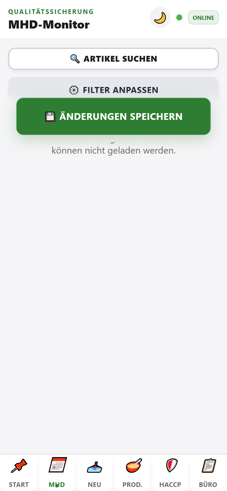
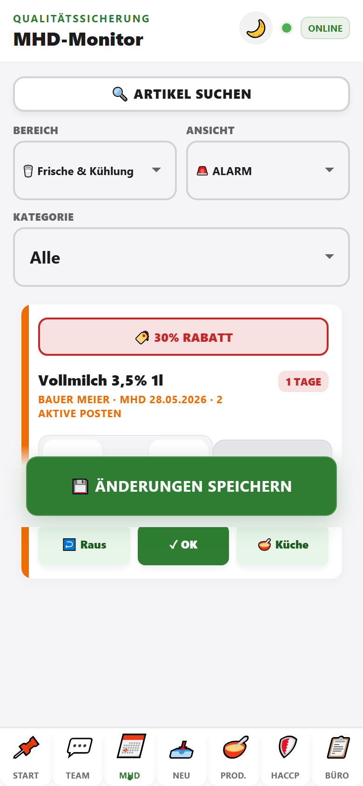
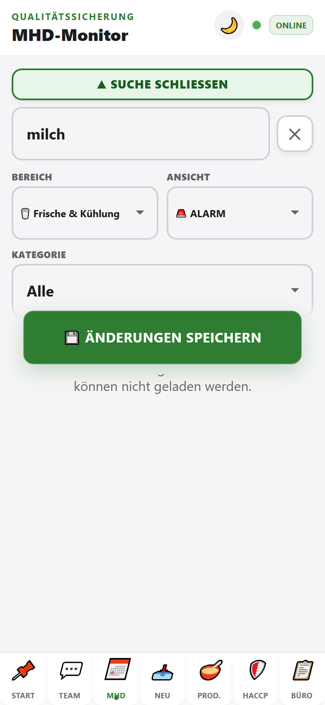

# MHD-Monitor

Der Tab **MHD** ist der zentrale Bereich für den täglichen Morgencheck: Welche Ware läuft in den nächsten Tagen ab, muss reduziert oder aus dem Verkauf?

## Wofür?

- Qualitätssicherung im Hofladen
- Startansicht **Alle (7 Tage)**: alle fälligen Posten der nächsten sieben Tage, sortiert zuerst nach Dringlichkeit (Überfällig / Heute / Morgen / …)
- Optional fokussieren auf **MoPro (0-2 Tage)**, **Kühlware (0-2 Tage)** oder **Trockenware (0-30 Tage)**
- Einzelne **Posten** bearbeiten (gleiche Artikel können mehrfach vorkommen)

## Rabatt-Empfehlung

Produktregeln gewinnen vor Kategorie-Regeln:

| Produkttyp | Rabatt |
|------------|--------|
| **Milch (Flasche/Tetrapack)** | 1 Tag vorher **10 %**, MHD-Tag **20 %**, sonst **Regulär** |
| **Kühlware / MoPro / Frische / Fleisch** | 2 Resttage **10 %**, 1 Resttag **20 %**, MHD-Tag **50 %**, sonst **Regulär** |
| **Trockenware / TK / Gewürze / Getränke** | ≤30 Tage **10 %**, ≤15 Tage **20 %**, ≤7 Tage **50 %**, sonst **Regulär** |

Bei **0 %** zeigt die Karte unauffällig **Regulär** und blendet das %-Badge aus.

Die Staffel ist mandantenspezifisch: In der Verwaltung unter **Mein Betrieb → MHD-Rabattstaffel** kann jeder Betrieb seine Stufen selbst speichern (Vorlagen pro Warengruppe, Speichern nur als Betriebs-Admin).

## Oberfläche

### 1. Filter (Toolbar)

| Element | Funktion |
|---------|----------|
| **Prüfgruppe** | **Alle (7 Tage)** (Standard), **MoPro (0-2 Tage)**, **Kühlware (0-2 Tage)** oder **Trockenware (0-30 Tage)** |

Die Toolbar ist auf dem Laden-iPhone einklappbar (**Suche/Filter**). Eingeklappt bleibt nur eine kompakte Zeile – so passen mehr MHD-Karten auf den Bildschirm. Die optionale **Erweiterte Suche** (Büro/Admin) steckt im aufgeklappten Panel, nicht als zweite Leiste über der Liste.

In der Ansicht **Alle** erscheinen Gruppenüberschriften nach Dringlichkeit (**Überfällig**, **Heute fällig**, **Morgen**, **In 2–4 Tagen**, **Später**). Bei gleichem Resttag stehen MoPro vor Kühlware vor Trockenware. Kritische Ware erscheint automatisch, sobald das MHD im gewählten Zeitraum liegt.

### 2. MHD-Karte (Posten)

Jede Karte ist **ein Posten** (eigenes MHD / eigene Lieferung).

- **Ampel oben rechts** (z. B. **IN 4 TAGEN**): antippen zeigt das genaue **MHD-Datum**; erneut tippen bringt die Resttage zurück
- **Kategorie-Badge oben**: antippen, wenn die Kategorie falsch ist; vor dem Speichern bestätigen wir die Änderung
- **MHD ändern**: korrigiert ein falsch erfasstes MHD nur für diesen Eintrag; vor dem Speichern bestätigen wir die Änderung
- **✏️ Bearbeiten**: öffnet **Artikel-Stammdaten bearbeiten** (Bezeichnung, Marke, EAN, MoPro/Kühlware oder Trockenware); nach dem Speichern zeigt unsere App den Artikel im passenden Filter
- **Menge**: **−** / **+** oder direkt in das Zahlenfeld tippen
- **🗑️ Ausverkauft** oder Wischen nach **links**
- **Aktionen**: **↩️ Raus** · **✓ OK** · **🥣 Küche** · **Box** *(nur StevesHof — Retter-Box vormerken)*
- **Reduziert**: Karte nach **rechts wischen**

### 3. Artikel suchen (optional)

1. **🔍 Artikel suchen** antippen
2. Suchbegriff eingeben (z. B. „milch“)
3. Mit **▲ Suche schließen** einklappen – der Kategorie-Filter bleibt aktiv

### 4. Speichern

**💾 Änderungen speichern** – bei aktivem Firebase-Sync werden Änderungen in die Cloud geschrieben.

## Ablauf Morgencheck

1. Tab **MHD** öffnen (beim Laden-iPhone automatisch)
2. Bei Bedarf **Zeitraum** und **Kategorie** wählen
3. Karten der Reihe nach abarbeiten
4. **Änderungen speichern**

## Retter-Box (StevesHof)

Mit **Box** in der MHD-Karte merken wir einen Posten für die heutige **Retter-Box** vor. Die Bestätigung lautet **Zur Retter-Box gelegt**.

**Drucken**, Rezeptvorschlag und Status (**Verkauft** / **Verwerfen**) erledigen wir im **Büro-Bereich** unter **Retter-Boxen** (Admin-Zugang). Am neutralen Laden-iPhone steht nur die **Box**-Aktion zur Verfügung.

## MHD-Eingabe absichern

Beim Einbuchen und Korrigieren prüft unsere App das Datum:

- **Jahr offensichtlich falsch** (z. B. 2002 statt 2026) → Speichern wird blockiert, wir müssen korrigieren
- **Schon abgelaufen** oder **Tag/Monat vertauscht** → Warnung mit Hinweis, bevor wir speichern
- In der Liste bleibt die Ampel unverändert: standardmäßig **Resttage**, Antippen zeigt das **echte MHD**

## Hinweise

- Die zweite Zeile zeigt **Hersteller / Zusatz** und das echte **MHD-Datum**
- Ohne Firebase-Verbindung erscheint ein Hinweis, dass keine MHD-Daten geladen werden können
