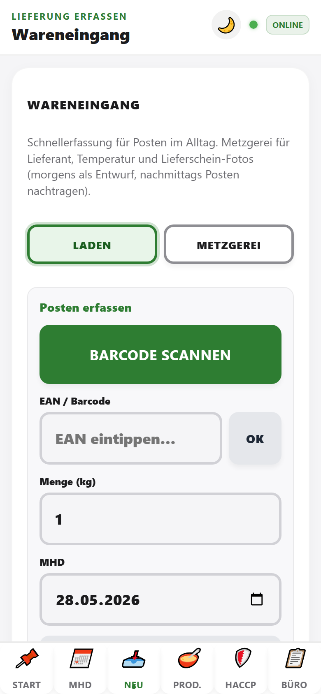
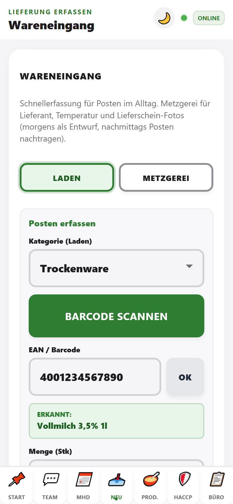

# Wareneingang (Tab „Neu“)

Hier erfassen wir **Lieferungen**: Lieferschein-Fotos, Lieferant, Temperatur und die einzelnen **Posten** (Artikel mit MHD).

> **TorFabrik (`torfabrik`):** Zusätzlich **„Lieferschein scannen (KI)“** (Gemini) – geparste Posten landen in `tenants/torfabrik/inventory`. Details: [KOLLEGEN_ANLEITUNG_TORFABRIK.md](../KOLLEGEN_ANLEITUNG_TORFABRIK.md).

## Zwei Bereiche

Oben wählen wir zuerst den **Lieferant** (Weiling, Naturverbund, Stautenhof, Sonstige oder Eigenproduktion). Danach wechseln wir zwischen:

| Modus | Inhalt |
|-------|--------|
| **Laden** | Kategorie, Barcode/EAN, Menge, MHD, Postenliste |
| **Metzgerei** | Waren-Kategorie, Temperatur, Lieferschein-Fotos/PDF |

Speichern-Buttons und **offene Lieferungen** gelten für die ganze Lieferung.

> **StevesHof Hofladen (`StevesHof_Hauptbetrieb`):** Nur der Bereich **Laden** ist aktiv (Metzgerei ausgeblendet). Der **Lieferant** bleibt oben sichtbar. Vor **MHD** und **Neu** wählen wir unser **Profil** (keine PIN). Posten sammeln wir in einer Lieferung und schließen mit **Gesamte Lieferung abschließen** ab. Der **KI-Lieferschein** ist am Laden-iPhone noch **nicht freigeschaltet** — bis dahin gilt der Barcode-Scan unten.

---

## Laden (Schnellerfassung)

### Schritte

1. Tab **Neu** → zuerst **Lieferant** wählen (Weiling, Naturverbund, Stautenhof, Sonstige oder Eigenproduktion)
2. **Laden** öffnen und **Kategorie (Laden)** wählen — Frische, MoPro, Kühlware, Aufschnitt, TK, Getränke, Trockenware oder Gewürze
3. **Barcode scannen** (grüner Button) oder **EAN** eintippen und **OK**
4. **Bekannte EAN**: Posten landet sofort als **oberste Karte** in der Liste (mit vorgeschlagenem MHD); der Scanner bleibt für den nächsten Artikel bereit
5. **Unbekannte EAN**: **Produktname** eintragen, Menge/MHD setzen und **➕ Posten hinzufügen**
6. Optional **Hersteller / Zusatz** ergänzen (erscheint später in der MHD-Ansicht)
7. Auf der Erfassungskarte korrigieren wir bei Bedarf **Menge** (Tap → Nummernpad), **MHD** (+3/+7/+14 Tage oder Tap auf das Datum) oder entfernen den Posten mit **✕**
8. **💾 Gesamte Lieferung abschließen** — fehlt der Lieferant, erscheint ein Auswahl-Pop-up
9. Optional **Letzte Eingänge** — Kategorien nachträglich korrigieren (siehe unten; für alle Nutzer mit Tab **Neu**)
10. Optional **Stammdaten** — nur Büro-/Admin-Zugang (gelernte EANs auf diesem Gerät)

### Kategorie bei Serien-Scans

Die ausgewählte Laden-Kategorie bleibt für den nächsten Scan erhalten. Wer gerade nur MoPro, Frische oder TK-Ware verräumt, muss die Kategorie daher nicht bei jedem Artikel neu auswählen.

Die Kategorie kann jederzeit geändert werden — sie gilt für den nächsten Posten.

Jeder neue Posten erscheint **oben** in der Liste (zuletzt gescannt zuerst), damit wir beim Auspacken nicht nach unten scrollen müssen.

### Letzte Eingänge korrigieren

Über **Letzte Eingänge** werden die zuletzt erfassten Wareneingänge angezeigt. Pro Artikel kann die Kategorie geprüft, per Dropdown geändert und mit **Kategorie speichern** berichtigt werden. Die Änderung wird auch bei schwacher Verbindung synchronisiert.

| Funktion | Zugriff |
|----------|---------|
| **Letzte Eingänge** (Button im Tab **Neu**) | Alle angemeldeten Nutzer mit sichtbarem Tab **Neu** — kein separater Büro-Login |
| **Stammdaten** | Nur Büro-/Admin-Konten |
| **Letzte Eingänge** (Tab **Büro**) | Zusätzlich im Büro-Bereich für Auswertung am Schreibtisch (gleiche Ansicht) |

Test- und Fehleinträge können dort auch **gelöscht** oder über **Posten ansehen** geöffnet werden.

### Scanner

- Barcode ins **grüne Feld** halten (ca. 15–25 cm Abstand)
- **Umverpackung / Karton:** lange Strichcodes mit Klammern wie `(01)…(15)…(10)…` etwas weiter weg halten (ca. 25–40 cm). Unsere App liest daraus die Artikelnummer und – wenn vorhanden – das MHD.
- Unten: **Eintippen** → Barcode manuell → **OK** (bei Kartons reicht die Zahl unter dem Strichcode bzw. die EAN aus dem `(01)`-Teil)
- Bekannte Artikel werden sofort eingebucht; der Scanner bleibt für den Serien-Scan offen
- Unbekannte Artikel wechseln in die manuelle Erfassung

### Posten erkannt

- Bekannte EAN: Quittungston und neue Karte ganz oben
- Auf der Karte: Menge tippen, MHD mit +3/+7/+14 anpassen oder Posten mit **✕** entfernen

---

## 📸 Lieferschein einlesen & abgleichen (KI-Wareneingang)

Wir scannen Artikel wie gewohnt und gleichen sie mit dem Lieferschein ab.

### Ablauf

1. Tab **Neu** → **Laden** → Artikel per **Barcode scannen** hinzufügen
2. **📄 Lieferschein hochladen** (PDF aus der Dateien-App) oder **📸 Lieferschein scannen (KI)** (Kamera)
3. Der **Lieferschein-Abgleich** zeigt:
   - noch nicht erfasste LS-Artikel
   - extra erfasste Posten
   - Mengenabweichungen
   - Übereinstimmungen
4. Nach weiteren Scans **Abgleich aktualisieren**
5. Optional fehlende LS-Artikel in den Bestand übernehmen

**🔎 Lieferschein abgleichen** öffnet den letzten Abgleich erneut.
### Vorgeschlagenes MHD aus Erfahrungswerten

Das MHD ist bereits vorausgefüllt. Dafür schaut unsere App in die Erfahrungswerte der letzten Lieferungen:

- Gab es denselben Artikel schon einmal, übernimmt sie die damals bewährte Haltbarkeits-Spanne und rechnet sie ab heute neu aus (Kennzeichen **Erfahrungswert**).
- Kennt unsere App den Artikel noch nicht, nutzt sie einen Standardwert je Warengruppe — z. B. MoPro/Milch **14 Tage**, Wurst **10 Tage**, Trockenware **90 Tage**; sonst **7 Tage** (Kennzeichen **Standard-Haltbarkeit**).

Wir können jedes vorgeschlagene MHD vor dem Einbuchen einfach als `TT.MM.JJJJ` anpassen. Mit jedem eingebuchten Lieferschein werden die Erfahrungswerte besser.

### Bestand

Beim Einbuchen erhöht unsere App den Bestand der gelieferten Artikel automatisch und legt jeden Artikel mit dem errechneten MHD im Tab **MHD** an.

---

## Metzgerei

### Schritte

1. Auf **Metzgerei** wechseln
2. **Waren-Kategorie** und **Temperatur (°C)**
3. **📸 Lieferscheine fotografieren / PDF** (mindestens ein Foto oder PDF für Entwurf)
4. **📝 Als offenen Entwurf speichern** – auch ohne Posten (morgens nur dokumentieren)

Mit **×** auf der Miniatur ein Foto wieder entfernen.

Bei Temperatur über 7 °C kann eine **Meister-Freigabe** (PIN) nötig sein.

---

## Lieferung abschließen

1. Oben **Lieferant** wählen (oder beim Abschließen im Pop-up nachholen)
2. Unter **Laden** mindestens einen Posten erfassen
3. Optional unter **Metzgerei** Temperatur und Fotos/PDF pflegen
4. **💾 Gesamte Lieferung abschließen**

## Offene Lieferungen (unten)

- Liste **📋 Offene Lieferungen zur Nachbearbeitung**
- Entwurf antippen → App springt zur Erfassung
- Posten anhand der Fotos nachtragen → **Lieferung abschließen**

## Wichtig

Jeder Wareneingang ist ein **eigener Posten** im Tab **MHD** – neue Lieferung ersetzt nicht automatisch alte Ware mit kurzem MHD.
