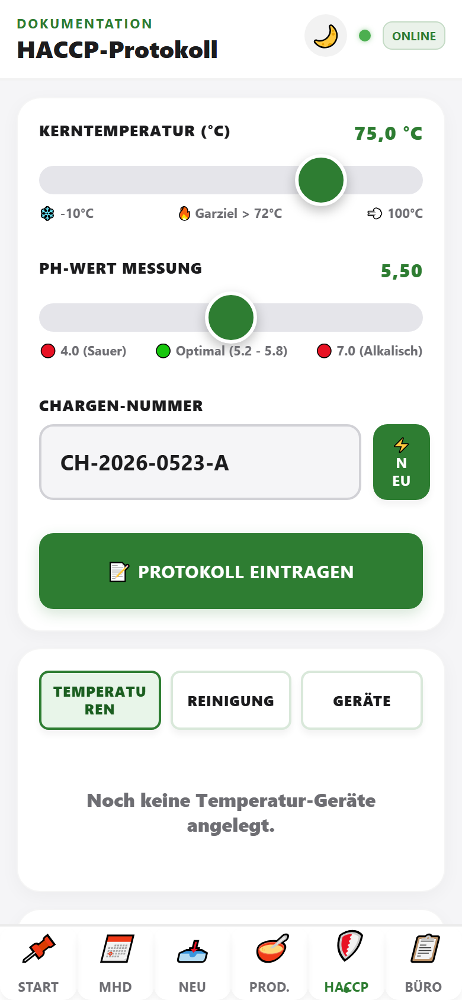

# HACCP

Dokumentation für Produktion (pH, Kerntemperatur, Charge) und **tägliche Betriebskontrollen** (Temperaturen, Reinigung, Kühlstellen).

> **Nav:** **Mehr → HACCP** (nicht mehr im Header-⚙️). Übersicht: [NAVIGATION.md](../NAVIGATION.md).

## Bereich 1: Produktions-Protokoll (oben)

Für einzelne Chargen / Produktionsschritte:

| Feld | Bedeutung |
|------|-----------|
| **Kerntemperatur** | Garziel u. a. > 72 °C |
| **pH-Wert** | Slider 4,0 – 7,0 (optimal ca. 5,2–5,8) |
| **Chargen-Nummer** | z. B. CH-2026-0523 – **⚡ Neu** erzeugt Nummer |
| **📝 Protokoll eintragen** | Speichern |

Bei Werten außerhalb der Toleranz erscheint eine **Warnung**.

## Bereich 2: Tageskontrollen (Mitte)

Umschalter:

- **Temperaturen** – Kühlstellen prüfen
- **Reinigung** – erledigte Reinigungen abhaken
- **Einrichten** – Kühlstellen und Reinigungsaufgaben anlegen oder deaktivieren

### Temperaturen (Temperatur-Rundgang)

Der Rundgang lädt die Messpunkte aus dem Mandanten (`haccp_geraete`) – nur Laden & Lager (kein Obergeschoss):

1. **Laden & Lager** – je Kühlstelle Sollbereich, Schnellwerte und ±0,5-°C-Stepper. Minuswerte (z. B. TK) tippen wir mit führendem `-` oder über den **±**-Button. Grün = im Soll, Rot = außerhalb.
2. **Ruhetage** – Geräte mit aktiven Wochentagen (z. B. Fleischtheke nur Do–Sa) bleiben an Ruhetagen **ausgeblendet** und brauchen keinen Messwert.
3. **RUNDGANG ABSPEICHERN & PROTOKOLLIEREN** – erst aktiv, wenn alle heute sichtbaren Stellen erfasst sind. Speichert unveränderlich in `haccp_logs` inkl. Bearbeiter.

**Erste Einrichtung:** Im Setup („+“) oder bei leerer Geräteliste den Button *StevesHof Standard-Geräte initial anlegen* tippen (Admin). Alternativ CLI: `npm run seed:haccp:steveshof`.

> **StevesHof Hofladen:** Wir dokumentieren Temperaturen und Reinigung **ausschließlich im Tab HACCP**. Der Tab **Team** ist für `StevesHof_Hauptbetrieb` deaktiviert.
>
> **Andere Mandanten:** Zusätzlich kann es dieselben Kühlstellen als schlanken Reiter **Temperatur-Check** im Tab **Team** geben (siehe [06-team.md](./06-team.md)). Reinigung, Einrichten und Druckansicht bleiben auf der HACCP-Seite.

### Reinigung

Pro Aufgabe **Reinigung erledigt** tippen.

Morgens typisch: **Temperaturen** → Werte eintragen → optional **Reinigung**.

Der Bereich **Einrichten** ist für seltene Änderungen gedacht, zum Beispiel wenn eine neue Kühlstelle dazukommt oder eine Reinigungsaufgabe nicht mehr aktiv ist.

## Bereich 3: Export / Büro (unten)

**🖨️ Druckansicht generieren** – Temperatur- und Reinigungsprotokolle der letzten 7 Tage als DIN-A4-Tabelle (Behördenkontrolle).

## Morgenroutine (Kurz)

1. **Mehr → HACCP**
2. **Temperaturen** prüfen und bestätigen
3. **Reinigung** dokumentieren
4. Bei Produktion: pH, Kerntemperatur und Charge im oberen Bereich erfassen
